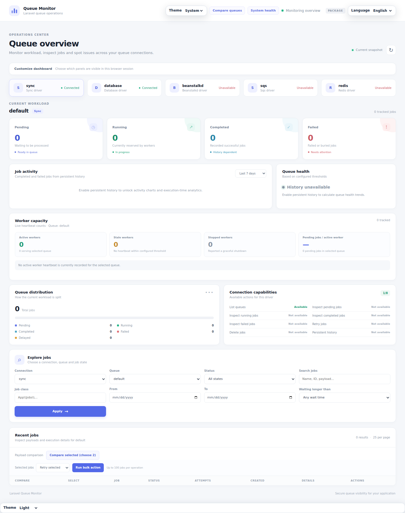
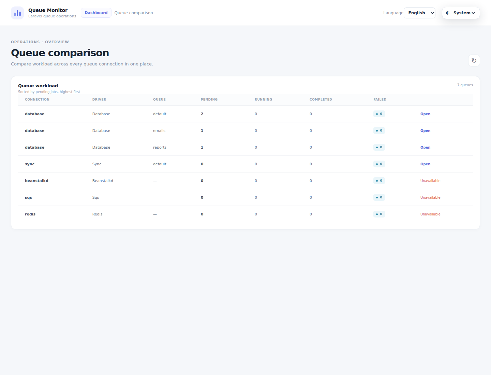

# Laravel Queue Monitor

[](https://packagist.org/packages/laravel-queue-monitor)
[](https://packagist.org/packages/laravel-queue-monitor)
[](https://packagist.org/packages/laravel-queue-monitor)
[](https://laravel.com)
[](https://github.com/mertaydin/laravel-queue-monitor/actions/workflows/tests.yml)
[](LICENSE)


Laravel uygulamalarındaki desteklenen kuyruk bağlantılarını izlemek ve yönetmek için geliştirilmiş bir pakettir.

> **Durum:** 1.0 öncesi sürüm. Kararlı 1.0 sürümünden önce API'ler ve yapılandırma seçenekleri değişebilir.

## Mevcut özellikler

- **Database kuyrukları:** Bekleyen, rezerve edilmiş, başarısız ve geçmişe kaydedilmiş tamamlanan işler.
- **Redis kuyrukları:** Bekleyen, rezerve edilmiş, gecikmeli ve geçmişe kaydedilmiş tamamlanan işler.
- **Beanstalkd kuyrukları:** Hazır, rezerve edilmiş, gecikmeli, gömülü (buried) ve tamamlanan iş sayıları.
- **Amazon SQS:** Standart ve FIFO kuyrukları için metrikler. SQS receipt handle değerleri kısa ömürlü olduğundan payload inceleme ve iş üzerinde işlem yapma özellikleri bilerek devre dışıdır.
- **Sync sürücüsü:** Tamamlanan ve başarısız işlerin geçmişi. Kuyruk derinliği ve kuyruk işlemleri desteklenmez.
- **İsteğe bağlı Supervisor entegrasyonu:** Yapılandırılmış programların durumunu görüntüleme, başlatma, durdurma ve yeniden başlatma.
- Kuyruk derinliği anlık görüntüleri, payload inceleme, yeniden deneme ve silme işlemleri.
- Sürücüye özel adaptörler ve desteklenen Laravel kuyruk bağlantılarının otomatik kaydı.
- İsteğe bağlı yaşam döngüsü geçmişi, batch kimlikleri ve zincirde kalan iş sayıları; hassas payload anahtarları özyinelemeli olarak maskelenir.
- Veritabanı, kuyruk bağlantıları, worker depolaması ve yapılandırılmış Supervisor sunucuları için isteğe bağlı salt okunur tanılama.

Paket geçmişi etkinleştirilmediği sürece tamamlanan işler saklanmaz; Laravel normalde başarılı işleri işlendikten sonra siler.

Geçmiş etkinleştirildiğinde panel; 24 saat, 7 gün ve 30 günlük etkinlik özetlerini, tamamlanan işlerin ortalama ve 95. yüzdelik sürelerini, en yavaş işleri, ortalama çalışma süresi en yüksek iş sınıflarını ve kuyruk sağlık göstergesini sunar. Analizler kaydedilmiş geçmişten hesaplanır ve geçmiş kapalıyken kullanılamaz. Uyarı eşiklerini `config/queue-monitor.php` içindeki `health.backlog_warning` ve `health.failure_rate_warning` ile yapılandırın.

## Gereksinimler

- PHP 8.2 veya üzeri
- Laravel 12 veya 13

Laravel 10 ve 11 güvenlik destek sürelerinin dışında olduğundan desteklenen sürüm aralığına dahil değildir.

## Kurulum

```bash
composer require mertaydin/laravel-queue-monitor
php artisan vendor:publish --tag=queue-monitor-config
php artisan migrate
php artisan vendor:publish --tag=queue-monitor-assets --force
```

Her paket güncellemesinden sonra en güncel panel JavaScript ve CSS dosyalarının yayımlanmış dosyaların üzerine yazılması için asset komutunu `--force` ile yeniden çalıştırın.

Geçmiş kaydını `config/queue-monitor.php` içinde etkinleştirin:

```php
'history' => [
    'enabled' => true,
    'connection' => env('QUEUE_MONITOR_DB_CONNECTION'),
    'table' => 'queue_monitor_jobs',
    'retention_days' => 14,
],
```

## Redis yapılandırması

Redis bağlantıları otomatik kaydedilir. Kuyruk adları varsayılan olarak Laravel bağlantısındaki `queue` değerini kullanır. Diğer kuyrukları açıkça ekleyebilirsiniz:

```php
'connections' => [
    'redis' => [
        'queues' => ['default', 'emails', 'reports'],
        'queue_prefix' => 'queues:',
    ],
],
```

Adaptör, Laravel Redis bekleyen listelerini ve rezerve/gecikmeli sorted set yapılarını okur. Tamamlanan işler için paket geçmişi gerekir. Başarısız işler Redis dışında Laravel'in failed-job sağlayıcısında tutulduğundan bu adaptör için başarısız iş incelemesi sunulmaz. Kuyruk keşfi yapılandırılmış kuyruk adlarını kullanır ve Redis `KEYS` komutunu çalıştırmaz.

Yeniden deneme, eşleşen rezerve edilmiş veya gecikmeli payload'ı bekleyen listeye taşır; zaten bekleyen işler değiştirilmez. Silme, payload'ı bulunduğu Redis yapısından kaldırır. Payload maskeleme varsayılan olarak açıktır.

## Amazon SQS desteği

SQS bağlantıları otomatik kaydedilir. Ana uygulamaya AWS SDK'yı yükleyin: `composer require aws/aws-sdk-php`. Her bağlantı için kuyruk adlarını yapılandırın. Standart ve FIFO kuyrukları aynı metrik adaptörünü kullanır.

```php
'connections' => [
    'sqs' => [
        'queues' => ['emails', 'emails.fifo'],
    ],
],
```

Adaptör yaklaşık bekleyen, işlemdeki ve gecikmeli mesaj sayılarını okur. Panel görüntülenirken receive count değerlerini değiştirmemek veya redrive politikalarını tetiklememek için mesajları teslim alıp incelemez. İş payload'ı inceleme, yeniden deneme ve silme desteklenmez. Geçmiş kaydı açıksa tamamlanan iş geçmişi kullanılabilir.

## Sync sürücüsü

Sync sürücüsü işleri anında çalıştırır ve kuyruk derinliği bulunmaz. Çalıştırma sonrasında tamamlanan ve başarısız işleri incelemek için paket geçmişini etkinleştirin. Bekleyen iş inceleme, yeniden deneme ve silme kullanılamaz.

## Beanstalkd desteği

Ana uygulamaya isteğe bağlı Beanstalkd istemcisini yükleyin:

```bash
composer require pda/pheanstalk:^5.0
```

Beanstalkd tube adları sunucudan keşfedilir. Kuyruk anlık görüntüleri hazır, rezerve, gecikmeli ve gömülü sayıları içerir; gömülü işler başarısız olarak gösterilir. Protokol rezerve sayısını bildirse de rezerve iş payload'larını listeleyemez. Pheanstalk peek komutları her tube için her durumda yalnızca sıradaki işi gösterebildiğinden adaptör durum ve tube başına en fazla bir incelenebilir iş döndürür. Yeniden deneme, gömülü veya gecikmeli işler için Beanstalkd kick işlemini kullanır. Tamamlanan iş ayrıntıları için paket geçmişi gerekir.

`config/queue-monitor.php` içinde yedek olarak tube adları tanımlayabilirsiniz:

```php
'connections' => [
    'beanstalkd' => [
        'queues' => ['default', 'emails'],
    ],
],
```

## Ekran görüntüleri

<!-- Ekran görüntüleri GitHub Actions tarafından güncel paket arayüzünden üretilir. -->

Görüntüler, GitHub Actions içinde geçici bir Laravel uygulamasında çalışan paketten alınır. Panel gerçek Blade görünümleriyle oluşturulur; kuyruk kayıtları ve worker heartbeat verileri geçici demo verileridir.

| Kuyruk paneli | Kuyruk karşılaştırması |
| --- | --- |
|  |  |

## Panel

Paket varsayılan olarak `/queue-monitor` adresinde duyarlı bir yönetim paneli sunar. Stil dosyası kurulum adımlarındaki `queue-monitor-assets` komutuyla yayımlanır.

Panel erişimi `web` middleware'i ile korunur. `app/Providers/AppServiceProvider.php` içinde uygulamaya özel yetkilendirme callback'i ekleyebilirsiniz:

```php
use Illuminate\Http\Request;
use MertAydin\LaravelQueueMonitor\Facades\QueueMonitor;

public function boot(): void
{
    QueueMonitor::auth(function (Request $request) {
        return $request->user()
            && $request->user()->hasRole('SuperAdmin');
    });
}
```

Erişime izin vermek için `true`, HTTP 403 döndürmek için `false` döndürün. Callback tanımlanmazsa erişim uygulamanızın kimlik doğrulama middleware yapılandırmasına bağlıdır.

`config/queue-monitor.php` içindeki `path` ile panel URL'sini değiştirebilirsiniz. Örneğin `'path' => 'panel/super/queue-monitor'` ayarı paneli `/panel/super/queue-monitor` adresine taşır. Aynı değer `QUEUE_MONITOR_PATH` ortam değişkeniyle de verilebilir; baştaki ve sondaki eğik çizgiler otomatik normalize edilir. Panelde `/queue-monitor/compare` adresinde bağlantılar arası kuyruk karşılaştırması, aranabilir iş listeleri, 25 kayıtlı sayfalama ve özel iş detay sayfası bulunur. Filtreler durum, kuyruk, iş sınıfı, oluşturulma tarih aralığı ve serbest metin aramasını kapsar. Arama iş adı, kimliği, maskelenmiş payload ve exception metnini tarar. Panel bölümleri oturum tabanlı tercihlerle gösterilip gizlenebilir. Otomatik yenileme 15, 30 veya 60 saniyeye ayarlanabilir ya da kapatılabilir. Panel, kullanılabilir iş durumlarını ve işlemleri sürücünün yeteneklerine göre gösterir. Yeniden deneme ve silme kontrolleri yalnızca seçilen durum/sürücü destekliyorsa sunulur. Değişiklikler POST/DELETE rotaları, Laravel CSRF koruması ve aynı callback yetkilendirmesiyle gerçekleştirilir.

Worker kapasite analizi etkin, eski ve durmuş heartbeat kayıtlarını özetler; kuyruk derinliği mevcutsa seçili kuyruk için etkin worker başına bekleyen iş sayısını hesaplar. CPU kullanımı veya yapılandırılmış worker limitlerini tahmin etmez. Heartbeat kayıtları `queue_monitor_workers` tablosunda tutulur. Veritabanını `workers.connection`, eski kayıt eşiğini `workers.stale_after_seconds` ile yapılandırın. Worker görünürlüğü Laravel worker yaşam döngüsü olayları ve hostname/PID heartbeat kayıtlarına dayanır. Supervisor program adlarını veya Supervisor'ın kendi süreç durumunu okuduğunu iddia etmez; bu ayrıntılar için Supervisor XML-RPC ya da ayrıca yapılandırılmış entegrasyon kullanın.

## Supervisor worker yönetimi

CI hattı geçici bir Supervisor sunucusu başlatır ve gerçek Supervisor daemon'una karşı süreç listeleme, durdurma ve başlatma entegrasyon testleri yapar. Üretim worker sunucularınıza erişim gerektirmez.

Supervisor entegrasyonu isteğe bağlıdır ve XML-RPC API'sini kullanır. Güvenilen sunucuları ve panelin görüntüleyip yönetebileceği süreç adlarını açıkça tanımlayın:

```php
'supervisor' => [
    'servers' => [
        'app-workers' => [
            'enabled' => true,
            'url' => env('QUEUE_MONITOR_SUPERVISOR_URL'),
            'username' => env('QUEUE_MONITOR_SUPERVISOR_USER'),
            'password' => env('QUEUE_MONITOR_SUPERVISOR_PASSWORD'),
            'verify_tls' => true,
            'allow_insecure_http' => env('QUEUE_MONITOR_SUPERVISOR_ALLOW_HTTP', false),
            'timeout' => 5,
            'programs' => ['laravel-worker:*'],
        ],
    ],
],
```

Yapılandırılmış süreçleri görüntülemek için `/queue-monitor/supervisor/app-workers` adresini açın. Başlatma, durdurma ve yeniden başlatma yalnızca `programs` izin listesindeki adlar için kullanılabilir. Joker karakter desteklenir. Süreç yönetimi için ayrıca `manageQueueWorkers` gate tanımlayın ve yönetim işlemlerini ayrı callback ile yetkilendirin.

HTTPS ve geçerli TLS sertifikaları kullanın. `allow_insecure_http` güvenilir özel uç nokta için açıkça etkinleştirilmedikçe düz HTTP engellenir. Supervisor RPC uç noktasını genel internete açmayın. Kimlik bilgilerini ortam değişkenlerinde saklayın. Süreç işlemleri POST ve Laravel CSRF koruması kullanır.

## Yeniden deneme politikası

Manuel yeniden deneme işlemlerinin belirli deneme sayısına ulaşmış işler için engellenmesi amacıyla `retry.max_attempts` değerini pozitif ayarlayın. Kuyruk bazında `retry.max_attempts_by_queue` ile sınırları özelleştirin. Varsayılan `0` sınırsız yeniden deneme anlamına gelir. Bu bir operatör güvenlik önlemidir; otomatik yeniden deneme zamanlamasını Laravel yönetir. Job sınıfında `backoff()` metodu veya worker'ın `--backoff` seçeneğini kullanabilirsiniz:

```php
class SendReport implements ShouldQueue
{
    public $tries = 5;

    public function backoff(): array
    {
        return [10, 30, 60];
    }
}
```

Paket yalnızca manuel yeniden deneme uygunluğunu kontrol eder. Otomatik yeniden deneme zamanlaması ve worker denemelerini Laravel yönetir.

## Bildirimler

Başarısız iş ve eşik uyarıları Slack, Microsoft Teams, Discord, Telegram ve genel JSON webhook'larını destekler. Bildirimler varsayılan olarak kapalıdır. Güvenilir webhook URL'lerini uygulama yapılandırmasına ekleyin; panel girdisinden webhook URL'si kabul etmeyin:

```php
'notifications' => [
    'enabled' => true,
    'timeout_seconds' => 3,
    'webhooks' => [
        env('QUEUE_MONITOR_ALERT_WEBHOOK'),
    ],
],
```

Kuyruk işi başarısız olduğunda paket uygulamaya özel entegrasyonlar (e-posta bildirimleri dahil) için `QueueAlertTriggered` olayı yayınlar ve yapılandırılmış webhook'lara kısa JSON mesajı gönderir. `queue-monitor:check-health` komutu birikmiş iş sayısını, eski worker'ları ve yakın dönem başarısızlık oranını da denetler. Eşik uyarıları almak için komutu her dakika zamanlayın. Yinelenen eşik uyarıları yapılandırılmış bekleme süresince bastırılır. Webhook hataları kuyruk işlemlerinden yalıtılmıştır. Webhook URL'lerini ve Telegram bot token'larını ortam değişkenlerinde sır olarak saklayın. Webhook'lar genel JSON gönderimi için düz URL veya `driver` ve `url` içeren yapılandırma dizileri olabilir.

Sağlayıcı örnekleri:

```php
'webhooks' => [
    ['driver' => 'slack', 'url' => env('QUEUE_MONITOR_SLACK_WEBHOOK')],
    ['driver' => 'discord', 'url' => env('QUEUE_MONITOR_DISCORD_WEBHOOK')],
    [
        'driver' => 'telegram',
        'url' => env('QUEUE_MONITOR_TELEGRAM_API_URL'), // https://api.telegram.org/bot<TOKEN>/sendMessage
        'chat_id' => env('QUEUE_MONITOR_TELEGRAM_CHAT_ID'),
    ],
],
```

Slack ve Teams `text`, Discord `content`, Telegram ise `chat_id` ve `text` alanlarını alır. Genel URL dizeleri tam JSON olay payload'ını almaya devam eder.

## Tasarım ilkeleri

- **Yeteneğe duyarlı:** Desteklenmeyen özellikler kullanılabilir gibi gösterilmez.
- **Geçmiş odaklı:** Tamamlanan iş geçmişi isteğe bağlıdır.
- **Varsayılan olarak güvenli:** Hassas payload değerleri varsayılan olarak maskelenir.
- **Laravel uyumlu:** Laravel kuyruk olayları, yapılandırma ve service container kullanılır.

## Panel dilleri

Panel İngilizce, Türkçe, Arapça, İspanyolca, Hintçe ve Basitleştirilmiş Çince dillerini içerir. Arapça sağdan sola (RTL) düzende görüntülenir.

## Ek dokümantasyon

- [Sağlık kontrolleri](docs/health-checks.md)
- [Sürüm yayınlama kontrol listesi](docs/releasing.md)
- [Kuyruk sürücüsü yetenekleri](docs/drivers.md)
- [Supervisor kurulumu ve kontrolleri](docs/supervisor.md)
- [Güvenlik rehberi](docs/security.md)

## Geliştirme

```bash
composer install
composer test
```

## Kuyruk SLA takibi

Kuyruk SLA takibi, işin kuyruğa eklenmesi ile worker tarafından alınması arasında geçen süreyi ölçer. Kalıcı geçmiş kaydı ve paket migration'ları gerektirir.

Varsayılan hedefi ve kuyruk bazında isteğe bağlı değerleri yapılandırın:

```php
'sla' => [
    'enabled' => true,
    'default_wait_seconds' => 30,
    'queues' => [
        'critical' => 10,
        'reports' => 120,
    ],
    'window_hours' => 24,
],
```

Panel, seçili bağlantı ve kuyruk için SLA uyumunu, ölçülen işleri ve ihlalleri gösterir. Bir iş yalnızca kuyrukta bekleme süresi yapılandırılmış sınırı aşarsa ihlal sayılır. Bekleyen işler mevcut bekleme süresiyle, başlamış işler kaydedilen bekleme süresiyle değerlendirilir. Bildirimler açıksa `queue-monitor:check-health` komutu hedef süresini aşan bekleyen işleri de raporlar. Uyarılar için komutu her dakika zamanlayın.

Mevcut kurulumlarda kuyruğa eklenme zamanı izleme sütunlarını eklemek için `php artisan migrate` çalıştırılmalıdır. SLA ölçümleri migration sonrasında kuyruğa eklenen işler için başlar; eski geçmiş kayıtları geriye dönük doldurulmaz.

## Dokümantasyon ve destek

- [Değişiklik günlüğü](CHANGELOG.md)
- [GitHub sürümleri](https://github.com/mertaydin/laravel-queue-monitor/releases)
- [Hata bildir / özellik iste](https://github.com/mertaydin/laravel-queue-monitor/issues)

## Lisans

MIT
